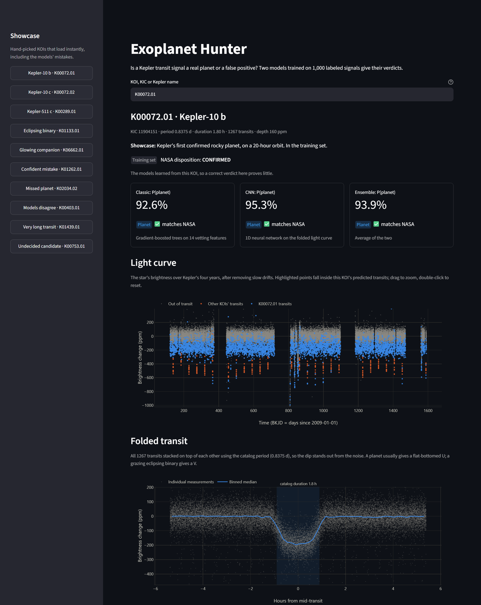
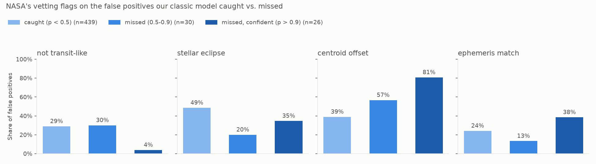
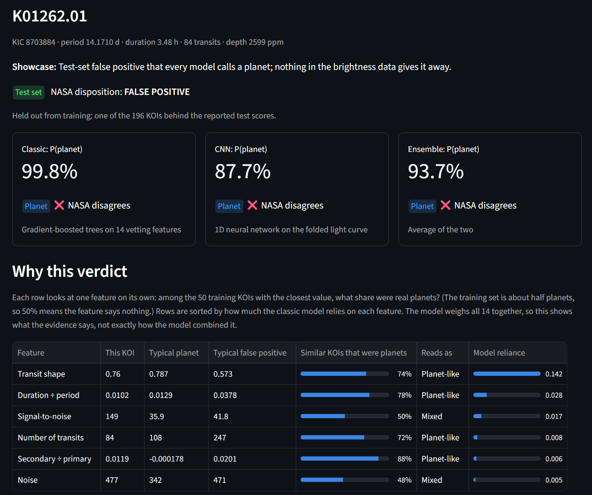

# Exoplanet Hunter

Classifies NASA Kepler transit signals as **real planets or false positives**, from raw light curves
to an interactive dashboard. Two models (gradient-boosted trees on hand-built vetting features, and a
1D CNN on the folded light curve) are trained on 1,000 labeled signals and tested on stars they never saw.



## What it does

- **Downloads and cleans raw Kepler data** from NASA's MAST archive: clips outliers, removes slow stellar
  drifts, and masks every known signal on the star so they can't contaminate each other.
- **Classic model:** 14 vetting features that target the ways impostors give themselves away (transit shape,
  odd/even eclipse depths, a secondary eclipse, duration vs. period, ...) feed a gradient-boosted tree model.
- **Deep model:** each signal becomes two fixed-size "views" (the whole orbit and a zoom on the transit), as in
  Google's AstroNet. A two-branch 1D CNN in PyTorch reads them directly.
- **Dashboard** (Streamlit): enter any of the ~9,500 Kepler signals and see the light curve, the folded transit,
  all three verdicts, *why* the models decided, and whether that KOI was in the training data.
- **Scores the 1,873 unresolved CANDIDATE signals** that NASA hasn't ruled on (see [Candidates](#candidates)).

## Results

Test set: 196 signals on 189 stars, split off **by star** before any training, so no star appears in both.

| Model | Accuracy | Precision | Recall | ROC AUC |
|---|---|---|---|---|
| Baseline trees (period, duration, depth only) | 0.821 | 0.827 | 0.835 | 0.874 |
| **Classic trees** (14 vetting features) | **0.929** | **0.908** | **0.961** | 0.962 |
| CNN (light-curve views only) | 0.867 | 0.874 | 0.874 | 0.941 |
| Ensemble (mean of trees + CNN) | 0.918 | 0.899 | 0.951 | **0.965** |

In plain terms, the classic model caught 99 of the 103 real planets and wrongly passed 10 of the 93 false
positives. For scale, Google's AstroNet trained on about 15,000 labeled signals; this project uses 1,000, with a
single CNN training run, so the CNN's numbers are noisy.

## Findings

**1. Transit shape does most of the work.** Shuffling the `shape_ratio` feature (flat-bottomed "U" planet
transit vs. pointed "V" eclipsing binary) drops test AUC by 0.142. The next most important feature drops it by
0.028.

**2. The confident mistakes have a physical explanation.** Most of the false positives the model is surest are
planets have the dip coming from a *neighboring* star whose light blends into the target's. NASA's own vetting
flags these with "centroid offset": the dip comes from a different spot on the detector than the star.



81% of the confident misses carry that flag, against 39% of the false positives the model catches
(Fisher exact p = 5e-5, over 495 labeled false positives using out-of-fold predictions). Light curves can't
show where on the detector the light comes from, so fixing this needs pixel-level centroid data, not a bigger
model. Signs that *are* visible in a light curve show the opposite pattern: the "stellar eclipse" flag appears on
49% of the false positives we catch but only 27% of the ones we miss.

**3. Averaging two models isn't automatically better.** The ensemble has the best AUC but lower accuracy than
the trees alone. On K00403.01, the CNN correctly says false positive (23%), the trees say planet (99%), and the
average sides with the trees.

## Candidates

<!-- TODO: fill in after score_candidates.py finishes: how many flagged, agreement between models,
     comparison with NASA's Robovetter score, top-flagged list. -->

*Results pending: the scoring run over all 1,873 candidates is in progress.*

## Dashboard

```bash
.venv\Scripts\python.exe -m streamlit run app.py
```

- Accepts a KOI (`K00072.01`, `KOI-72.01`), a star (`KIC 11904151`) or a planet name (`Kepler-10 b`).
- **Dataset badge:** *training set* (a correct answer proves little), *test set*, *unseen* (one of ~6,500 labeled
  signals outside the 1,000 sampled for training, a fresh check) or *candidate* (no answer exists yet).
- **"Why this verdict":** for each important feature, the share of real planets among the 50 training signals
  with the closest value.
- **Showcase sidebar:** ten hand-picked signals that load instantly, including the models' mistakes.
- Stars outside the local cache are downloaded from MAST on demand (usually 10–60 s).
- `?koi=K01262.01` in the URL opens a specific signal.

The model's most confident test-set mistake, as the dashboard shows it. Every feature the model relies on
looks planet-like, so nothing in the light curve gives the impostor away (verdict cards and feature table
cropped from the same page):



## How it works

```
MAST light curve ──► clean: clip outliers, Savitzky-Golay flatten (~2-day window), mask all known signals
                 ──► fold on NASA's catalog period / mid-transit time / duration
                 ├─► 14 vetting features ──► gradient-boosted trees ─┐
                 └─► global (2001-bin) + local (201-bin) views ──► 1D CNN ─┴─► mean = ensemble
```

Design choices that matter for honest numbers:

- **Split by star, not by signal.** Several planets on one star share a light curve, so they must land on the
  same side of the split. The split is saved once and reused by every model.
- **Train only on CONFIRMED vs. FALSE POSITIVE.** Unresolved candidates are held out entirely.
- **The dashboard reproduces training exactly.** `python inference.py --parity` re-scores the whole test set
  through the dashboard's code path and checks it matches the saved results (it does: identical features,
  probabilities within 2e-7).

More detail on methods, design decisions and errors: [WRITEUP.md](WRITEUP.md).

## Limitations

- **Brightness only.** No pixel or centroid data, so blended background binaries fool it (finding 2).
- **Small training set** (1,000 signals) and a single CNN training run.
- **The labels come largely from NASA's own vetting**, so the models partly learn to imitate it. Agreement with
  NASA is not independent proof of being right.
- **It classifies signals NASA already found**, using NASA's period and timing; it doesn't search for new ones.
  (A transit search is implemented and recovers Kepler-10 b and c, but it isn't part of the classifier.)
- **Transits longer than 15 hours were excluded from training.** The dashboard warns when one is entered.
- Runs locally; not hosted.

## Run it yourself

Windows / PowerShell, Python 3.11.

```bash
python -m venv .venv
```
```bash
.venv\Scripts\python.exe -m pip install -r requirements.txt
```
```bash
.venv\Scripts\python.exe -m streamlit run app.py
```

The trained models (`models/`, 1.2 MB) and the showcase data (`data/demo/`) are in the repo, so the dashboard
runs straight away. Showcase signals load instantly; anything else downloads from MAST.

To rebuild everything from scratch, run the scripts in order. `build_features.py` downloads about 6 GB of light
curves (several hours, resumable):

```
build_koi_list.py → build_features.py → train_classifier.py → build_views.py → train_cnn.py
                  → build_demo.py → score_candidates.py → robovetter.py
```

## Project layout

| File | Role |
|---|---|
| `fetch_lightcurve.py`, `clean_lightcurve.py`, `search_transits.py` | Download, clean, and BLS transit search (Kepler-10 demo) |
| `build_koi_list.py` | Pulls NASA's KOI catalog, builds the balanced labeled set |
| `extract_features.py`, `build_features.py` | Vetting features for one / all signals |
| `train_classifier.py` | Star-level split, cross-validation, gradient-boosted trees |
| `build_views.py`, `train_cnn.py` | CNN inputs and the two-branch 1D CNN |
| `inference.py` | Scores any catalog signal end to end (shared by dashboard and batch) |
| `app.py`, `figures.py`, `build_demo.py` | Streamlit dashboard, its charts, and the showcase data |
| `score_candidates.py`, `robovetter.py` | Candidate scoring, comparison with NASA's vetting flags |

## Credits

Data from NASA's Kepler mission via the [NASA Exoplanet Archive](https://exoplanetarchive.ipac.caltech.edu/)
(cumulative KOI table) and [MAST](https://archive.stsci.edu/). Built with
[lightkurve](https://docs.lightkurve.org/), astropy, scikit-learn, PyTorch, Streamlit and Plotly. The CNN design
follows Shallue & Vanderburg (2018), *Identifying Exoplanets with Deep Learning* (AstroNet).
